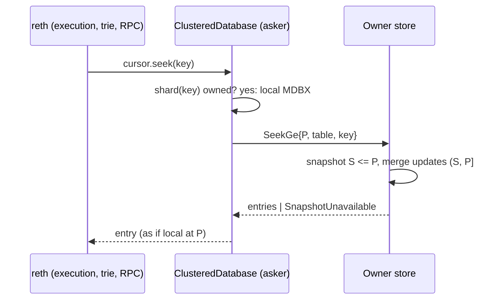

# base-execution-cluster

Clustered Base: state sharding for a group of co-trusted Base execution nodes. Each node stores
only some shards of the live state (accounts, storage, trie nodes, bytecode) and reads the rest
from peers, so that N nodes no longer need N full copies of the state database. This crate holds
the shard map, the sharded database wrapper, the peer read protocol, and the owner-side store that
answers peer reads.

Status: experiment. Not safe for production; peers are trusted and unauthenticated.

## Scope

Sharded: the MDBX tables `HashedAccounts`, `HashedStorages`, `AccountsTrie`, `StoragesTrie`,
`Bytecodes`. Base runs reth storage v2, so the trie tables are read and written through their
packed-key views (`PackedAccountsTrie`, `PackedStoragesTrie`). Everything else (block indexes,
stage checkpoints, static files, `RocksDB` history) is kept in full on every node.

Non-goals: Byzantine peers, history sharding, pipeline (backfill) sync on a clustered node,
historical state RPC older than the persisted tip, reth storage v1.

## Placement

- A shard is one value of the first byte of a hash: 256 shards.
- `HashedAccounts`, `HashedStorages`, `StoragesTrie`: shard = first byte of the hashed address,
  except for the storage of a split contract (below).
- `AccountsTrie`: shard = first two nibbles of the trie path (byte 0 of the packed key). Paths
  shorter than two nibbles (the root and its 16 children) are **replicated**: stored and written
  on every node.
- `Bytecodes`: shard = first byte of the code hash.
- Owners of a shard: the `R` storage nodes with the highest rendezvous score
  `keccak(shard || node_id)`. `R >= 2` by default, so one node can be down. A node with
  `storage = false` owns nothing (a stateless node) but still holds the replicated keys.
- Adding or removing a node moves only the shards whose top-`R` set changes.
- The packed `AccountsTrie` key is 33 bytes: 32 bytes of packed nibbles, then the nibble count.
  A key is replicated when that count is below 2. `node_id` is a `u64`, hashed as 8 big-endian
  bytes after the shard byte.
- **Split contracts** (large contracts listed in `split_storage`): their storage rows are placed
  one by one by subkey, so one contract's storage spreads over all 256 shards. A
  `HashedStorages` row is in the shard of the first byte of its hashed slot. A `StoragesTrie` row
  is placed by its trie path exactly as an `AccountsTrie` key is: the first two nibbles, and
  paths shorter than two nibbles (the contract's storage root and its 16 children) are
  replicated. The part of a split contract in one shard is a **range**; a node holds the ranges
  of the shards it owns. Rows of every other contract are placed by hashed address as above.
  Reads, writes, shed and the owner store all use this one placement, per key and subkey.
- `split_storage` lists 20-byte addresses (hashed with keccak at load) or 32-byte hashed
  addresses (used as they are), told apart by length; any other entry is rejected. Absent or
  empty: no contract is split.
- A node reads the placement from a TOML file. The file is rejected when node ids repeat,
  `node_id` is not listed, `R` is 0 or larger than the number of storage nodes, or the retention
  window `W` (see [Owner side](#owner-side)) is below 160, or `apply_from` (see
  [Apply mode](#apply-mode)) lists an unknown node or this node, or a `split_storage` entry is
  neither 20 nor 32 bytes. Every node must list the same `split_storage`; this is not checked
  (see [Limits](#limits)).

```toml
node_id = 1          # this node
replication = 2      # R, optional, default 2
retention_blocks = 160  # W, optional, default 160
apply_from = [2]     # optional, default [] (execute); see Apply mode
split_storage = ["0x4200000000000000000000000000000000000016"]  # optional, default []

[[nodes]]
id = 1
address = "10.0.0.1:9650"
storage = true       # optional, default true

[[nodes]]
id = 2
address = "10.0.0.2:9650"
```

## Read rule

A read of a key this node does not own must return exactly what this node's own MDBX would have
returned at the transaction's snapshot if the node stored everything. That snapshot is the node's
persisted tip `P`: the `Finish` stage checkpoint visible in the same MDBX transaction. reth layers
its in-memory blocks above `P` itself, so nothing in reth needs to know the read was remote.

Consequences:

- Every remote read carries `P` (block number, and hash when known). The owner answers as of `P`,
  never as of its own head.
- Results may be cached for the lifetime of one transaction or cursor only.
- The owner refuses when it cannot reproduce `P` (it is behind, has discarded `P`, or is on a
  different fork). The asker then tries the next owner, and retries for a bounded time when every
  owner is merely behind.
- `Bytecodes` is the exception: entries are content-addressed and never change, so an owner
  answers from its newest data without reproducing `P`.

### Routing

Routing applies to read-only transactions of a clustered database. Read-write transactions read
local MDBX only (see [Write rule](#write-rule)).

- A key is read from local MDBX when this node holds it (it is replicated or in an owned shard)
  and from an owner otherwise. The decision is made from the placement alone, never from what
  local MDBX happens to contain: a node whose MDBX still has keys of shards it does not own (shed
  has not run or not finished) reads exactly as a shed node does. In a shard this node does not
  own, the only local keys that count are the replicated `AccountsTrie` paths.
- Shards are contiguous key ranges (the first key byte), so an ordered walk visits them one at a
  time: owned shards from local MDBX, other shards with `SeekGe` pages. In every shard the
  replicated `AccountsTrie` paths of that byte range (the root in shard 0, the one-nibble path
  `n` in shard `n0`) sort before every sharded key and are read locally, because `SeekGe` never
  returns them.
- A split contract is read the same way one level down: its ranges are contiguous subkey ranges
  (the first subkey byte), and "the first duplicate with subkey `>=` X" (`seek_by_key_subkey`,
  and `seek_exact`, `get` and `next_dup`, which ask for the first duplicate from the smallest
  subkey or from after the current one) starts in X's range: its replicated storage-trie paths
  from local MDBX, then the range from local MDBX when this node holds it and from an owner with
  a `SeekDupGe` page otherwise. When the range has no such duplicate, the read continues with the
  next range, local or remote as placement says, until a duplicate is found or the contract's
  256 ranges are exhausted. Local reads of a split contract use a second MDBX cursor of the same
  table, which works on encoded keys and is opened only when the cursor first reads a split
  contract. Contracts outside `split_storage` are read as before, by key, with no continuation.
- One read of a split contract (one `seek_exact`, `get`, `seek_by_key_subkey`, or `next_dup` that
  continues past the current page or local range) has one deadline, 2 seconds after it starts
  (the default retry budget of one remote read). Every range it visits, owner it asks, connect,
  frame write and frame read, and retry pause inside it finishes by that deadline, each socket
  operation waiting only the time left. Running out of time is a `DatabaseError`, never
  "absent".
- The cursor keeps its own position; after a remote answer the MDBX cursor's position is
  meaningless.
- A remote failure is a `DatabaseError`, never "absent".

Cursor operations on the sharded tables:

| Operation | `HashedAccounts`, `AccountsTrie` | `Bytecodes` | `HashedStorages`, `StoragesTrie` |
|---|---|---|---|
| `get`, `get_by_encoded_key`, `seek_exact` | yes | yes | yes (first duplicate of the key, across ranges for a split contract) |
| `current` | yes | yes | yes |
| `first`, `seek`, `next`, forward walks | yes | only inside owned shards | error |
| `seek_by_key_subkey`, `next_dup`, `next_dup_val`, `walk_dup` with a key | | | yes |
| `last`, `prev`, reverse walks, `prev_dup`, `last_dup`, `next_no_dup`, `walk_dup` without a key | error | error | error |

"Error" means a `DatabaseError` on every clustered read-only cursor of that table, even when the
node holds the key, so behaviour does not depend on placement. No live read path needs these
operations; reth's account and storage cursors (`DatabaseHashedCursorFactory`,
`DatabaseTrieCursorFactory`) and its state providers use only the supported ones.

Cursor states match MDBX: a fresh cursor's `next` is `first`; after a positioning call finds
nothing, `current` and `next` return nothing; after `next` runs past the last entry, `current`
still returns the last entry.

## Write rule

In a read-write transaction, a write (`put`, `upsert`, `insert`, `append`, `append_dup`) to a key
this node does not hold is dropped, and every read is local. Local MDBX never holds a value for
such a key once shed has run, and before that only a stale one; forward persistence of new blocks
only reads state tables to decide between insert, update and delete of the same key, whose write
is dropped anyway, so this is sufficient there. Deletes run locally (a stale key is simply
removed).

A write of a duplicate of a split contract is kept or dropped by the duplicate's own placement:
its subkey is the start of the encoded value. Whole-contract operations act on the rows this
node holds: `delete_current_duplicates` on a split contract deletes its local rows only. reth's
live persistence of the sharded tables never uses it (only `PlainStorageState`, which is not
sharded, is wiped that way); a wiped storage reaches the hashed tables as one zeroed slot per
row, each placed by its subkey.

It is not sufficient for anything that computes from state inside a write transaction:

- Genesis initialisation and pipeline stages must run on an unclustered (pass-through) database.
- A reorg that reaches persisted blocks recomputes trie reverts from state reads and would
  corrupt the replicated trie nodes. A clustered node stops instead and must be re-cloned.

Both are enforced at commit. Live persistence advances every stage checkpoint to the same block
in the transaction that advances `Finish`, so a read-write commit is refused with a
`DatabaseError` (nothing is written) when:

- the `Headers` or `Bodies` checkpoint is ahead of `Finish`: reth's staged pipeline is running;
- `Finish` is below the last committed `Finish`: blocks are being unwound.

## Persistence points

After a read-write commit, the database opens a raw MDBX read snapshot and registers it with the
owner store at that snapshot's `Finish` block, when that block differs from the last one
registered. The block hash comes from a lookup the node installs once its provider exists; until
it is installed, or while it does not know the block, no point is registered. The node registers
the initial point at startup, right after installing the lookup.

## Operating requirements

A clustered node refuses to start unless:

- `--engine.num-state-masking-blocks` is 0 (Base's default). With masking, the state tables lag
  the `Finish` checkpoint and `P` no longer identifies their contents.
- State roots are computed for every block, so every canonical block carries trie updates
  (`--debug.skip-state-root` is refused: skipped blocks carry empty trie updates, which an owner
  cannot tell from real ones).
- The datadir is initialised: genesis is written (a `Finish` checkpoint exists).

A node is clustered when started with `--cluster.config <FILE>` (`base rpc` and the `node`
command); without it the database is a pass-through to MDBX. At startup a clustered node checks
the requirements above before opening anything, opens the clustered database, starts its owner server on its configured
address, launches, and sheds in the background. Once its provider exists it installs the
block-hash lookup, registers the initial persistence point, and feeds every canonical block
(including reorgs) to its owner store, with updates `None` when a notification lacks them. It
logs the shards it owns and shed progress, and counts remote reads and failures in the metrics
`base_cluster_remote_reads` and `base_cluster_remote_read_failures`. Every 10 seconds in which
any remote read happened it logs `cluster remote reads` with the reads of each kind (`gets`,
`seeks`, `duplicate_seeks`), the `failures`, and the total time spent in them (`elapsed`) since
the previous line; `ClusterNode::remote_reads` returns the same counts since start.

The block-hash lookup holds the provider only weakly; the feed task holds it strongly. The
provider owns the clustered database, which owns the node, so a strong lookup would keep the
node, its owner listener and its held snapshots alive forever. Once the feed task stops (at
shutdown) the lookup knows no block and no further persistence point is registered.


## Owner side

An owner answers "state at `P`" from:

- a held MDBX read snapshot at one of its own persistence points `S <= P` (long-read safety
  disabled for that transaction), plus
- the sorted hashed-state and trie updates of canonical blocks `(S, P]`, retained from
  canonical-state notifications and applied oldest to newest.

In those updates a deletion is always explicit and per key: an account or trie node of `None`, a
storage slot of zero. There is no "wipe storage" or "delete trie" marker to honour. reth's
in-memory cursor overlays (`HashedPostStateCursorFactory`, `InMemoryTrieCursorFactory`) already
implement this merge over a database cursor factory.
Because deletions are per slot and per trie path, a wiped storage of a split contract needs no
special case: each owner applies the deletions of the ranges it serves.

Retention: an owner keeps snapshots and per-block updates covering the last `W` blocks, `W >= 160`
(Base's persistence backpressure threshold), set by `retention_blocks` in the cluster config. Each retained block is identified by number and hash;
an owner serves `P` only when its retained chain from `S` to `P` is unbroken. A block that arrives
without trie updates makes the owner unable to serve past it.

- The window is `[head - W + 1, head]`, where `head` is the newest block or persistence point the
  owner has seen. `P` outside it is refused with `SnapshotUnavailable`.
- A block or persistence point at an already retained number replaces it and drops everything
  retained above it (a reorg of in-memory blocks).
- `P` with a hash that differs from the owner's block at that number is refused with `WrongFork`.
  Any other way of failing to reach `P` (a gap, a block without trie updates, no snapshot at or
  below `P`) is `SnapshotUnavailable`. Its range is the lowest and highest block the owner can
  serve; the owner may still refuse blocks inside it.

Serving never issues a remote read: an owner serves only shards it owns, and for a split
contract only the ranges of shards it owns.

## Wire protocol

Keys and values travel as the encoded table bytes MDBX stores, so the protocol is table-agnostic.

| Request | Tables | Response |
|---|---|---|
| `Get { table, key }` | `HashedAccounts`, `AccountsTrie`, `Bytecodes` | value or absent |
| `SeekGe { table, key, limit }` | `HashedAccounts`, `AccountsTrie` | up to `limit` entries with key `>=` the given key, ascending, within the key's shard; `end_of_shard` flag |
| `SeekDupGe { table, key, subkey, limit }` | `HashedStorages`, `StoragesTrie` | up to `limit` duplicate entries of exactly `key` with subkey `>=` the given subkey; for a split contract only within the subkey's range; `end_of_key` flag |
| `ExecutedBlock { hash }` | none (see [Apply mode](#apply-mode)) | the block's encoded execution result |

Every request carries the snapshot `P`. Errors: `SnapshotUnavailable` (with the range the owner can
serve), `WrongFork`, `NotOwner`, `Unsupported`, and `NotAvailable` for `ExecutedBlock`. Iterating
across keys of a duplicate-key table is `Unsupported` remotely; no live read path needs it, and so
is a key or subkey of the wrong length.

- The shard of a `SeekGe` is the shard of its key. Replicated `AccountsTrie` keys are never
  returned by `SeekGe` (every node holds them), but `Get` answers them.
- A `SeekDupGe` of a split contract is served by the owners of its subkey's range (the shard of
  the subkey's first byte) and refused with `NotOwner` elsewhere. Its page ends at the range
  boundary: `end_of_key` then means "no more duplicates in this range", and the asker continues
  with the next range. Replicated storage-trie paths are never returned. The owner derives the
  range from the subkey and its own `split_storage`, so the encoding is unchanged.
- An owner may return fewer than `limit` entries without setting the end flag; the asker seeks
  again from after the last entry.
- `Bytecodes`: an owner that lacks the code and has not persisted up to `P` refuses with
  `SnapshotUnavailable` instead of answering absent. The range it advertises ends at its newest
  persistence point, not at its newest retained block, so the asker sees it as behind and
  retries until the owner persists the code.
- Each message is a 4-byte big-endian length followed by the bincode (standard configuration)
  encoding of the request, or of the response-or-error. An owner that fails internally (a
  database error) closes the connection, and the asker treats it like an unreachable owner.
- The asker tries the owners in rendezvous order, skipping itself. It retries the round, for a
  bounded time, only when every owner was unreachable or behind (`SnapshotUnavailable` with no
  range or a range below `P`) and at least one was behind. Any other refusal is returned. Within a
  read of a split contract the retries also end at that read's deadline (see [Routing](#routing)).

Transport is blocking sockets with a small connection pool, because reads happen inside
synchronous cursor calls on engine and trie worker threads. Owners serve from their own threads.
The owner's accepting thread polls its listener every 10 ms instead of blocking in `accept`, so
stopping the server never depends on a connection arriving.



## Apply mode

A node in apply mode does not execute the blocks its consensus layer delivers: it takes each
block's execution result from a peer that executed it, checks it against the header, and inserts
it as an executed block. Persistence, canonical notifications, the owner feed, the pool and RPC
then see an executed block as usual. It saves the execution's remote reads on a node that stores
few or no shards.

- Roles: an **executor** executes blocks as today and serves their results; an **apply node**
  asks executors for results. Either may store shards or none. Every clustered node serves the
  results of blocks it inserted (executed or applied), so any node can be an executor.
- Config: `apply_from = [ids]` at the top level of the cluster TOML lists the nodes this node
  asks, in order. Absent or empty: the node executes. An id that is not a cluster node, or is
  this node, is rejected.
- Executor: keeps the results of its 64 most recent inserted blocks, keyed by block hash, filled
  from the engine's block-added event (the earliest point a complete result exists, before
  forkchoice). A result holds the receipts, requests, gas used, blob gas used, the bundle state
  with reverts, the transaction senders, and the block's sorted hashed state and trie updates.
  One worker encodes results in event order, so a result never evicts a newer one; at most 64
  inserted blocks wait for it. A block inserted while 64 wait is not kept (apply nodes asking
  for it execute it) and is counted in `base_cluster_dropped_results`. A result that would not
  fit in a response frame (`Frame::MAX_LEN`) is not kept. The worker stops with the event stream.
- Wire: `Get` gains a sibling query `ExecutedBlock { hash }` on the owner port (its snapshot and
  table are ignored). The executor answers the encoded result, waiting up to 250 ms for a block
  it has not inserted yet, or refuses with `NotAvailable`. Other requests keep their encoding.
- Apply node, for each new payload: convert the payload and run the header, header-against-parent
  and pre-execution body checks, as execution does; ask the `apply_from` nodes in order before
  one deadline 400 ms from the first request; then check the result: it carries no execution
  requests (Base produces none, and reth's post-execution checks do not read them), and it passes
  the post-execution checks execution runs: gas used, receipts root and logs bloom (reth's
  consensus), and Base's message-passer storage root and block-time checks against the result's
  hashed state.
- Fetch deadline: the deadline bounds every connect, write and read of every node asked, each
  socket operation waiting only the time left, and an answer completed after it is a miss
  (`unavailable`). A pooled connection gets its usual timeouts back afterwards.
- Trusted, not checked: the state root (the hashed state and trie updates are not recomputed),
  the bundle state, and the senders (signatures are not recovered).
- Fallback: when no result arrives in time, a peer is unreachable, the result does not decode or
  fails a check, the payload carries a block access list, or the parent's header or state is not
  available (a parent off the canonical chain), the node logs a warning and executes the block
  exactly as today. Apply mode never stalls a node and never changes what it accepts. Blocks
  downloaded from the network (not new payloads) are always executed.
- Counters: applied blocks, fallbacks by reason (`unavailable`, `unreachable`, `invalid`,
  `ineligible`) and time spent fetching, in `ClusterNode::applied_blocks`, the metrics
  `base_cluster_applied_blocks` and `base_cluster_apply_fallbacks{reason}`, and a `cluster apply`
  log line every 10 seconds in which a block was applied or fell back.

Limits: the fetch runs on the engine thread, so a slow executor delays forkchoice handling by up
to the 400 ms deadline per block. Two nodes that apply from each other only wait for each other and
then execute. An apply node does not warm reth's execution cache, so a fallback execution starts
cold.

## Bootstrap

Start from a full datadir (genesis initialised or snapshot restored on a pass-through database).
Shedding deletes every row of a sharded table that the node does not hold, including the ranges
of split contracts in shards it does not own. It runs on raw MDBX in
the background after launch, in batches of bounded size, each its own short write transaction so
the engine's persistence writer never waits long. Reads do not depend on it (see
[Routing](#routing)), and writes never add such keys, so it is idempotent and a node stopped
mid-shed resumes on its next start. Scale-up copies a shard from an owner at a persisted tip;
scale-down sheds it.

### Filtered copy

`base cluster bootstrap --from <full datadir> --cluster.config <FILE> --to <new datadir>` writes
a clustered node's state database directly from a full node's, instead of copying the whole
datadir and shedding. `--cluster.config` and `--to` repeat, paired by position, to write several
nodes' databases in one pass over the source. For each node it creates `<to>/db` holding every
table of `<from>/db` that reth's schema declares (`Tables::ALL`): unsharded tables row for row,
and for the five sharded tables only the rows that node holds by [placement](#placement):
replicated `AccountsTrie` paths are kept, and a split contract's rows are placed one by one by
subkey, its replicated storage-trie paths kept. The result is identical, row for row and byte for
byte, to a full copy on which that node's shed has finished, so a node started on it behaves
exactly as one started on a full copy.

- The source must be a full node that is stopped. The command refuses when reth's `db/lock` file
  names a live process, and holds that lock while it copies, so a node cannot start on the
  source meanwhile (it creates and removes the lock file; no table of the source changes). It
  also refuses when the source has no `Finish` stage checkpoint, when a `<to>/db` exists and is
  not empty, and when a config does not list its `node_id`; then nothing is created.
- The pairs are refused when their counts differ, when two share a `--to` path or a `node_id`,
  or when the configs differ in anything but `node_id` and `apply_from` (node list, replication,
  retention, split contracts), since the nodes would not agree on placement.
- A row of a sharded table that cannot be placed (a key or split-contract subkey of the wrong
  encoding) stops the copy with an error; nothing is dropped silently.
- Rows move as raw bytes in source order, in MDBX append mode. The source is read in parallel,
  because a cold read is bound by the disk's random-read latency: one cursor walk faults in one
  page at a time, while many concurrent walks keep the disk busy. Each table is split into
  partitions of consecutive rows, about 4 mebibytes of the table's pages each (from MDBX's page
  counts). Partition boundaries are 4-byte key prefixes spaced evenly over the key space.
  Each `split_storage` contract in a duplicate-key sharded table gets as many partitions again,
  at subkey prefixes; its first partition starts at the contract's first row, so rows that sort
  before the first prefix (short storage-trie paths) are kept. `--read-threads` reader threads
  (default 16; 1 reads with a single thread) each hold their own read transaction and cursor on
  the source (long-read safety disabled; the source is stopped). They claim partitions in order,
  at most `--read-threads` at once counted from the one being written, and place each row once.
  One thread takes the partitions strictly in order and hands their rows, in shared batches of
  up to 16 384 rows or 1 mebibyte, to one writer thread per destination, which appends those its
  node holds. So every destination receives the rows in exactly source order, and a run uses
  the readers, that thread, and one thread per destination.
- Memory is bounded: each partition being read queues at most 8 batches, so at most
  `read threads x 9` batches are read ahead (about 200 mebibytes at 16 threads, since a
  batch is at most about 1.4 mebibytes with its row index), plus 8 batches queued per writer.
  The slowest destination sets the pace.
- Parallelism needs keys spread over the key space. A table keyed by a big-endian block number
  is one partition and is read by one thread. A giant contract that is not in `split_storage`
  lies in one partition: one thread walks it, and while it is being written the other readers
  can read at most the window ahead and then wait. Use the storage report (below) to find such
  contracts and list them before bootstrapping.
- Each destination commits once the rows or bytes written to it since its last commit reach
  100 000 rows or 256 mebibytes, with MDBX's `SafeNoSync` sync mode, and all are synced to disk
  once at the end. The first error of any writer, else of a reader, stops every thread of the
  run, and a panicking thread's panic is propagated. An interrupted run leaves partial
  databases: delete every `<to>/db` and run again; there is no resume.
- It logs each table at start and finish (rows read, and rows written per destination) and every
  10 million rows of a large table, and prints a summary per destination: rows and bytes of each
  sharded table kept against the source and of the unsharded tables together; then the elapsed
  time and the contracts with the most `HashedStorages` rows (see below).
- Only `<to>/db` is written. The operator provides the rest of the datadir from the stopped
  source: `static_files` and `rocksdb` copied in full (they are not sharded), and `reth.toml` and
  any other node files as for any copied datadir. Consensus-layer files live outside the
  execution datadir and are handled as for any new node.
- `split_storage` must be final before bootstrapping: rows of split contracts in ranges the node
  does not own are never copied.

### Choosing split contracts

`base cluster storage-report --from <datadir> [--top N] [--read-threads T]` walks
`HashedStorages` of `<datadir>/db` once, read-only, and prints the `N` (default 20) hashed
addresses with the most rows, each with its row count and share of the table, then the table's
total, and last a ready `split_storage = [...]` line listing the hashed addresses that hold at
least 1% of the rows. `T` threads (default 16) count the table's partitions (as in the
bootstrap) in any order. A thread that sees one contract reach 1 000 000 rows hands the
contract's values with a greater first byte to the other threads, one range per byte, and the
pieces are summed, so no single thread walks a giant contract. The counts are the same as a
single walk's. It takes no lock; on a running node its long read transactions keep MDBX from
reusing pages until it finishes, so prefer a stopped node.

## Limits

- A clustered node can only follow the chain live. It must be re-cloned when it falls behind by
  more than the engine's backfill threshold, when it restarts more than `W` blocks behind its
  peers, or when a reorg reaches persisted blocks.
- A read-only transaction older than `W` blocks (a long trace, for example) fails on its next
  remote read.
- One network round trip per remote seek until read-ahead batching is tuned. A walk asks every
  shard it crosses that this node does not own, even an empty one.
- An owner answers a bytecode only once it has persisted it, so reading code from a block this
  node persisted before every owner of the code's shard did waits for an owner to persist it,
  and fails if none does within the client's retry budget (2 s by default).
- `entries` (table statistics) of a sharded table counts local rows only.
- Shedding frees pages inside MDBX but does not shrink the file without a compacting copy.
- `split_storage` must be identical on every node. Nothing checks it: a node with a different
  list asks the wrong owners and reads wrong data. Changing the list (on every node) needs a
  re-clone from a full datadir, because rows already shed under the old placement are gone.
- Split contracts are chosen by the operator; nothing detects large contracts or rebalances.
- A read of a split contract that finds nothing in a range asks the next range, so a seek past
  the last slot of a range that this node does not hold costs one more remote read per empty
  range crossed. Large contracts are dense, so this is rare. A seek past a contract's last slot
  visits every remaining range, and a read of a contract with no storage visits all 256: with
  1 ms round trips that is about 256 ms, and with slow owners the read fails at its 2-second
  deadline. Ranges are asked one after another, and an owner that timed out is asked again for
  the next range.
- A storage wipe of a split contract is applied per row and per range like any other deletion.
  A wipe of an existing contract cannot happen after Cancun, so this cost is not optimised.

## Design record

Decided after a two-seat, two-pass design review on 2026-11-12.

- Rejected: "the owner may answer as of any block between the asker's persisted tip and its head".
  It is wrong for RPC at a non-head in-memory block, for side forks, and wherever reth reads the
  table under a deleted overlay entry.
- Rejected: a cluster-wide frozen or aligned persistence point. `P` is already fixed per
  transaction, and reth decides when to persist.
- Rejected: reusing reth's `OverlayStateProviderFactory` on the owner. Below the owner's own tip it
  computes reverts from database reads, which would touch shards the owner does not hold.
- Not verified by test at the time of writing: page-reuse cost of the held read snapshots, and
  that no Base execution extension on the node-run path reads state inside a write transaction.
