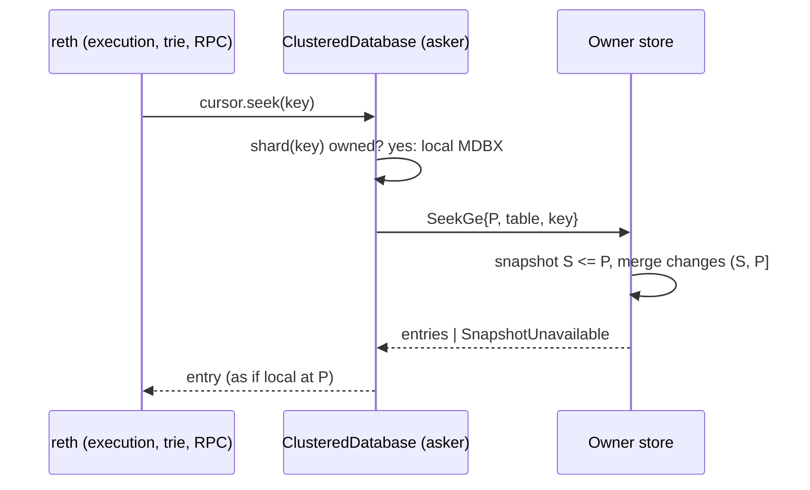

# base-execution-cluster

Clustered Base: state sharding for a group of co-trusted Base execution nodes. Each node stores
only some shards of the live state (accounts, storage, trie nodes, bytecode) and reads the rest
from peers, so that N nodes no longer need N full copies of the state database. This crate holds
the shard map, the sharded database wrapper, the peer read protocol, and the owner-side store that
answers peer reads.

Status: experiment. Not safe for production; peers are trusted and unauthenticated.

Implemented so far: `ClusteredDatabase`, the database the Base node launches on. It wraps the MDBX
environment with its own transaction (`ClusteredTx`) and cursor (`ClusteredCursor`) types and
currently forwards every operation unchanged, so it behaves exactly like MDBX. Placement, routing
and the peer protocol below are not implemented yet.

## Scope

Sharded: the MDBX tables `HashedAccounts`, `HashedStorages`, `AccountsTrie`, `StoragesTrie`,
`Bytecodes`. Everything else (block indexes, stage checkpoints, static files, `RocksDB` history) is
kept in full on every node.

Non-goals: Byzantine peers, history sharding, pipeline (backfill) sync on a clustered node,
historical state RPC older than the persisted tip, reth storage v1.

## Placement

- A shard is one value of the first byte of a hash: 256 shards.
- `HashedAccounts`, `HashedStorages`, `StoragesTrie`: shard = first byte of the hashed address.
- `AccountsTrie`: shard = first two nibbles of the trie path. Paths shorter than two nibbles (the
  root and its 16 children) are **replicated**: stored and written on every node.
- `Bytecodes`: shard = first byte of the code hash.
- Owners of a shard: the `R` storage nodes with the highest rendezvous score
  `keccak(shard || node_id)`. `R >= 2` by default, so one node can be down. A node with
  `storage = false` owns nothing (a stateless node) but still holds the replicated keys.
- Adding or removing a node moves only the shards whose top-`R` set changes.

## Read rule

A read of a key this node does not own must return exactly what this node's own MDBX would have
returned at the transaction's snapshot if the node stored everything. That snapshot is the node's
persisted tip `P`: the `Finish` stage checkpoint visible in the same MDBX transaction. reth layers
its in-memory blocks above `P` itself, so nothing in reth needs to know the read was remote.

Consequences:

- Every remote read carries `P` (block number, and hash when known). The owner answers as of `P`,
  never as of its own head.
- Results may be cached for the lifetime of one transaction only.
- The owner refuses when it cannot reproduce `P` (it is behind, has discarded `P`, or is on a
  different fork). The asker then tries the next owner, and retries for a bounded time when every
  owner is merely behind.

## Write rule

In a read-write transaction, a write to a key this node does not own is dropped, and a read of
such a key returns "absent". Live persistence only reads state tables to decide between insert,
update and delete, so this is sufficient there. It is not sufficient for anything that computes
from state inside a write transaction: genesis initialisation and pipeline stages must run on an
unclustered (pass-through) database.

## Owner side

An owner answers "state at `P`" from:

- a held MDBX read snapshot `S <= P` (it keeps the last few persistence points open), plus
- the per-block sorted state and trie changes of canonical blocks `(S, P]`, retained from
  canonical-state notifications.

The newest change wins; a deletion or storage wipe hides everything older. Serving never issues a
remote read: an owner serves only shards it owns.

## Wire protocol

Keys and values travel as the encoded table bytes MDBX stores, so the protocol is table-agnostic.

| Request | Tables | Response |
|---|---|---|
| `Get { table, key }` | `HashedAccounts`, `AccountsTrie`, `Bytecodes` | value or absent |
| `SeekGe { table, key, limit }` | `HashedAccounts`, `AccountsTrie` | up to `limit` entries with key `>=` the given key, ascending, within the key's shard; `end_of_shard` flag |
| `SeekDupGe { table, key, subkey, limit }` | `HashedStorages`, `StoragesTrie` | up to `limit` duplicate entries of exactly `key` with subkey `>=` the given subkey; `end_of_key` flag |

Every request carries the snapshot `P`. Errors: `SnapshotUnavailable` (with the range the owner can
serve), `WrongFork`, `NotOwner`, `Unsupported`. Iterating across keys of a duplicate-key table is
`Unsupported` remotely; no live read path needs it.

## Bootstrap

Start from a full datadir (genesis initialised or snapshot restored on a pass-through database),
then `shed`: delete every key of a shard the node does not own. Scale-up copies a shard from an
owner at a persisted tip; scale-down sheds it.

## Limits

- A clustered node can only follow the chain live. If it falls behind by more than the engine's
  backfill threshold, pipeline sync would read an incomplete database; re-clone it instead.
- One network round trip per remote seek until read-ahead batching is tuned.
- Shedding frees pages inside MDBX but does not shrink the file without a compacting copy.
