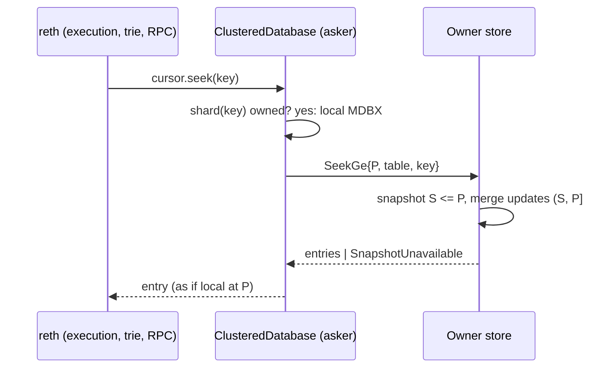

# base-execution-cluster

Clustered Base: state sharding for a group of co-trusted Base execution nodes. Each node stores
only some shards of the live state (accounts, storage, trie nodes, bytecode) and reads the rest
from peers, so that N nodes no longer need N full copies of the state database. This crate holds
the shard map, the sharded database wrapper, the peer read protocol, and the owner-side store that
answers peer reads.

Status: experiment. Not safe for production; peers are trusted and unauthenticated.

## Scope

Sharded: the MDBX tables `HashedAccounts`, `HashedStorages`, `AccountsTrie`, `StoragesTrie`,
`Bytecodes`. Base runs reth storage v2, so the trie tables are read and written through their
packed-key views (`PackedAccountsTrie`, `PackedStoragesTrie`). Everything else (block indexes,
stage checkpoints, static files, `RocksDB` history) is kept in full on every node.

Non-goals: Byzantine peers, history sharding, pipeline (backfill) sync on a clustered node,
historical state RPC older than the persisted tip, reth storage v1.

## Placement

- A shard is one value of the first byte of a hash: 256 shards.
- `HashedAccounts`, `HashedStorages`, `StoragesTrie`: shard = first byte of the hashed address.
- `AccountsTrie`: shard = first two nibbles of the trie path (byte 0 of the packed key). Paths
  shorter than two nibbles (the root and its 16 children) are **replicated**: stored and written
  on every node.
- `Bytecodes`: shard = first byte of the code hash.
- Owners of a shard: the `R` storage nodes with the highest rendezvous score
  `keccak(shard || node_id)`. `R >= 2` by default, so one node can be down. A node with
  `storage = false` owns nothing (a stateless node) but still holds the replicated keys.
- Adding or removing a node moves only the shards whose top-`R` set changes.
- The packed `AccountsTrie` key is 33 bytes: 32 bytes of packed nibbles, then the nibble count.
  A key is replicated when that count is below 2. `node_id` is a `u64`, hashed as 8 big-endian
  bytes after the shard byte.
- A node reads the placement from a TOML file. The file is rejected when node ids repeat,
  `node_id` is not listed, `R` is 0 or larger than the number of storage nodes, or the retention
  window `W` (see [Owner side](#owner-side)) is below 160.

```toml
node_id = 1          # this node
replication = 2      # R, optional, default 2
retention_blocks = 160  # W, optional, default 160

[[nodes]]
id = 1
address = "10.0.0.1:9650"
storage = true       # optional, default true

[[nodes]]
id = 2
address = "10.0.0.2:9650"
```

## Read rule

A read of a key this node does not own must return exactly what this node's own MDBX would have
returned at the transaction's snapshot if the node stored everything. That snapshot is the node's
persisted tip `P`: the `Finish` stage checkpoint visible in the same MDBX transaction. reth layers
its in-memory blocks above `P` itself, so nothing in reth needs to know the read was remote.

Consequences:

- Every remote read carries `P` (block number, and hash when known). The owner answers as of `P`,
  never as of its own head.
- Results may be cached for the lifetime of one transaction or cursor only.
- The owner refuses when it cannot reproduce `P` (it is behind, has discarded `P`, or is on a
  different fork). The asker then tries the next owner, and retries for a bounded time when every
  owner is merely behind.
- `Bytecodes` is the exception: entries are content-addressed and never change, so an owner
  answers from its newest data without reproducing `P`.

### Routing

Routing applies to read-only transactions of a clustered database. Read-write transactions read
local MDBX only (see [Write rule](#write-rule)).

- A key is read from local MDBX when this node holds it (it is replicated or in an owned shard)
  and from an owner otherwise. The decision is made from the placement alone, never from what
  local MDBX happens to contain: a node whose MDBX still has keys of shards it does not own (shed
  has not run or not finished) reads exactly as a shed node does. In a shard this node does not
  own, the only local keys that count are the replicated `AccountsTrie` paths.
- Shards are contiguous key ranges (the first key byte), so an ordered walk visits them one at a
  time: owned shards from local MDBX, other shards with `SeekGe` pages. In every shard the
  replicated `AccountsTrie` paths of that byte range (the root in shard 0, the one-nibble path
  `n` in shard `n0`) sort before every sharded key and are read locally, because `SeekGe` never
  returns them.
- The cursor keeps its own position; after a remote answer the MDBX cursor's position is
  meaningless.
- A remote failure is a `DatabaseError`, never "absent".

Cursor operations on the sharded tables:

| Operation | `HashedAccounts`, `AccountsTrie` | `Bytecodes` | `HashedStorages`, `StoragesTrie` |
|---|---|---|---|
| `get`, `get_by_encoded_key`, `seek_exact` | yes | yes | yes (first duplicate of the key) |
| `current` | yes | yes | yes |
| `first`, `seek`, `next`, forward walks | yes | only inside owned shards | error |
| `seek_by_key_subkey`, `next_dup`, `next_dup_val`, `walk_dup` with a key | | | yes |
| `last`, `prev`, reverse walks, `prev_dup`, `last_dup`, `next_no_dup`, `walk_dup` without a key | error | error | error |

"Error" means a `DatabaseError` on every clustered read-only cursor of that table, even when the
node holds the key, so behaviour does not depend on placement. No live read path needs these
operations; reth's account and storage cursors (`DatabaseHashedCursorFactory`,
`DatabaseTrieCursorFactory`) and its state providers use only the supported ones.

Cursor states match MDBX: a fresh cursor's `next` is `first`; after a positioning call finds
nothing, `current` and `next` return nothing; after `next` runs past the last entry, `current`
still returns the last entry.

## Write rule

In a read-write transaction, a write (`put`, `upsert`, `insert`, `append`, `append_dup`) to a key
this node does not hold is dropped, and every read is local. Local MDBX never holds a value for
such a key once shed has run, and before that only a stale one; forward persistence of new blocks
only reads state tables to decide between insert, update and delete of the same key, whose write
is dropped anyway, so this is sufficient there. Deletes run locally (a stale key is simply
removed).

It is not sufficient for anything that computes from state inside a write transaction:

- Genesis initialisation and pipeline stages must run on an unclustered (pass-through) database.
- A reorg that reaches persisted blocks recomputes trie reverts from state reads and would
  corrupt the replicated trie nodes. A clustered node stops instead and must be re-cloned.

Both are enforced at commit. Live persistence advances every stage checkpoint to the same block
in the transaction that advances `Finish`, so a read-write commit is refused with a
`DatabaseError` (nothing is written) when:

- the `Headers` or `Bodies` checkpoint is ahead of `Finish`: reth's staged pipeline is running;
- `Finish` is below the last committed `Finish`: blocks are being unwound.

## Persistence points

After a read-write commit, the database opens a raw MDBX read snapshot and registers it with the
owner store at that snapshot's `Finish` block, when that block differs from the last one
registered. The block hash comes from a lookup the node installs once its provider exists; until
it is installed, or while it does not know the block, no point is registered. The node registers
the initial point at startup, right after installing the lookup.

## Operating requirements

A clustered node refuses to start unless:

- `--engine.num-state-masking-blocks` is 0 (Base's default). With masking, the state tables lag
  the `Finish` checkpoint and `P` no longer identifies their contents.
- State roots are computed for every block, so every canonical block carries trie updates.
- The datadir is initialised: genesis is written (a `Finish` checkpoint exists).

A node is clustered when started with `--cluster.config <FILE>` (`base rpc` and the `node`
command); without it the database is a pass-through to MDBX. At startup a clustered node checks
the requirements above, opens the clustered database, starts its owner server on its configured
address, launches, and sheds in the background. Once its provider exists it installs the
block-hash lookup, registers the initial persistence point, and feeds every canonical block
(including reorgs) to its owner store, with updates `None` when a notification lacks them. It
logs the shards it owns and shed progress, and counts remote reads and failures in the metrics
`base_cluster_remote_reads` and `base_cluster_remote_read_failures`.


## Owner side

An owner answers "state at `P`" from:

- a held MDBX read snapshot at one of its own persistence points `S <= P` (long-read safety
  disabled for that transaction), plus
- the sorted hashed-state and trie updates of canonical blocks `(S, P]`, retained from
  canonical-state notifications and applied oldest to newest.

In those updates a deletion is always explicit and per key: an account or trie node of `None`, a
storage slot of zero. There is no "wipe storage" or "delete trie" marker to honour. reth's
in-memory cursor overlays (`HashedPostStateCursorFactory`, `InMemoryTrieCursorFactory`) already
implement this merge over a database cursor factory.

Retention: an owner keeps snapshots and per-block updates covering the last `W` blocks, `W >= 160`
(Base's persistence backpressure threshold), set by `retention_blocks` in the cluster config. Each retained block is identified by number and hash;
an owner serves `P` only when its retained chain from `S` to `P` is unbroken. A block that arrives
without trie updates makes the owner unable to serve past it.

- The window is `[head - W + 1, head]`, where `head` is the newest block or persistence point the
  owner has seen. `P` outside it is refused with `SnapshotUnavailable`.
- A block or persistence point at an already retained number replaces it and drops everything
  retained above it (a reorg of in-memory blocks).
- `P` with a hash that differs from the owner's block at that number is refused with `WrongFork`.
  Any other way of failing to reach `P` (a gap, a block without trie updates, no snapshot at or
  below `P`) is `SnapshotUnavailable`. Its range is the lowest and highest block the owner can
  serve; the owner may still refuse blocks inside it.

Serving never issues a remote read: an owner serves only shards it owns.

## Wire protocol

Keys and values travel as the encoded table bytes MDBX stores, so the protocol is table-agnostic.

| Request | Tables | Response |
|---|---|---|
| `Get { table, key }` | `HashedAccounts`, `AccountsTrie`, `Bytecodes` | value or absent |
| `SeekGe { table, key, limit }` | `HashedAccounts`, `AccountsTrie` | up to `limit` entries with key `>=` the given key, ascending, within the key's shard; `end_of_shard` flag |
| `SeekDupGe { table, key, subkey, limit }` | `HashedStorages`, `StoragesTrie` | up to `limit` duplicate entries of exactly `key` with subkey `>=` the given subkey; `end_of_key` flag |

Every request carries the snapshot `P`. Errors: `SnapshotUnavailable` (with the range the owner can
serve), `WrongFork`, `NotOwner`, `Unsupported`. Iterating across keys of a duplicate-key table is
`Unsupported` remotely; no live read path needs it, and so is a key or subkey of the wrong length.

- The shard of a `SeekGe` is the shard of its key. Replicated `AccountsTrie` keys are never
  returned by `SeekGe` (every node holds them), but `Get` answers them.
- An owner may return fewer than `limit` entries without setting the end flag; the asker seeks
  again from after the last entry.
- `Bytecodes`: an owner that lacks the code and has not persisted up to `P` refuses with
  `SnapshotUnavailable` instead of answering absent.
- Each message is a 4-byte big-endian length followed by the bincode (standard configuration)
  encoding of the request, or of the response-or-error. An owner that fails internally (a
  database error) closes the connection, and the asker treats it like an unreachable owner.
- The asker tries the owners in rendezvous order, skipping itself. It retries the round, for a
  bounded time, only when every owner was unreachable or behind (`SnapshotUnavailable` with no
  range or a range below `P`) and at least one was behind. Any other refusal is returned.

Transport is blocking sockets with a small connection pool, because reads happen inside
synchronous cursor calls on engine and trie worker threads. Owners serve from their own threads.



## Bootstrap

Start from a full datadir (genesis initialised or snapshot restored on a pass-through database).
Shedding deletes every key of a sharded table that the node does not hold. It runs on raw MDBX in
the background after launch, in batches of bounded size, each its own short write transaction so
the engine's persistence writer never waits long. Reads do not depend on it (see
[Routing](#routing)), and writes never add such keys, so it is idempotent and a node stopped
mid-shed resumes on its next start. Scale-up copies a shard from an owner at a persisted tip;
scale-down sheds it.

## Limits

- A clustered node can only follow the chain live. It must be re-cloned when it falls behind by
  more than the engine's backfill threshold, when it restarts more than `W` blocks behind its
  peers, or when a reorg reaches persisted blocks.
- A read-only transaction older than `W` blocks (a long trace, for example) fails on its next
  remote read.
- One network round trip per remote seek until read-ahead batching is tuned. A walk asks every
  shard it crosses that this node does not own, even an empty one.
- An owner answers a bytecode only once it has persisted it, so reading code from a block this
  node persisted before every owner of the code's shard did fails once the client's retry budget
  runs out.
- `entries` (table statistics) of a sharded table counts local rows only.
- Shedding frees pages inside MDBX but does not shrink the file without a compacting copy.

## Design record

Decided after a two-seat, two-pass design review on 2026-11-12.

- Rejected: "the owner may answer as of any block between the asker's persisted tip and its head".
  It is wrong for RPC at a non-head in-memory block, for side forks, and wherever reth reads the
  table under a deleted overlay entry.
- Rejected: a cluster-wide frozen or aligned persistence point. `P` is already fixed per
  transaction, and reth decides when to persist.
- Rejected: reusing reth's `OverlayStateProviderFactory` on the owner. Below the owner's own tip it
  computes reverts from database reads, which would touch shards the owner does not hold.
- Not verified by test at the time of writing: page-reuse cost of the held read snapshots, and
  that no Base execution extension on the node-run path reads state inside a write transaction.
