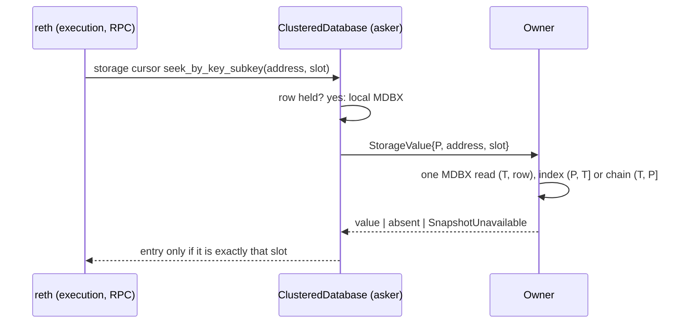

# base-execution-cluster

Clustered Base: state sharding for a group of co-trusted Base execution nodes. Each node stores
only some shards of the live state (accounts, storage, trie nodes, bytecode) and reads the rest
from peers, so that N nodes no longer need N full copies of the state database. This crate holds
the shard map, the sharded database wrapper, the peer read protocol, and the owner-side store that
answers peer reads.

Status: experiment. Not safe for production; peers are trusted and unauthenticated.

## Scope

Sharded: the MDBX tables `HashedAccounts`, `HashedStorages`, `AccountsTrie`, `StoragesTrie`,
`Bytecodes`. Base runs reth storage v2, so the trie tables are read and written through their
packed-key views (`PackedAccountsTrie`, `PackedStoragesTrie`). Everything else (block indexes,
stage checkpoints, static files, `RocksDB` history) is kept in full on every node.

Non-goals: Byzantine peers, history sharding, pipeline (backfill) sync on a clustered node,
historical state RPC older than the persisted tip, reth storage v1.

## Placement

- A shard is one value of the first byte of a hash: 256 shards.
- `HashedAccounts`, `HashedStorages`, `StoragesTrie`: shard = first byte of the hashed address,
  except for the storage of a split contract (below).
- `AccountsTrie`: shard = first two nibbles of the trie path (byte 0 of the packed key). Paths
  shorter than two nibbles (the root and its 16 children) are **replicated**: stored and written
  on every node.
- `Bytecodes`: shard = first byte of the code hash.
- Owners of a shard: the `R` storage nodes with the highest rendezvous score
  `keccak(shard || node_id)`. `R >= 2` by default, so one node can be down. A node with
  `storage = false` owns nothing (a stateless node) but still holds the replicated keys.
- Adding or removing a node moves only the shards whose top-`R` set changes.
- The packed `AccountsTrie` key is 33 bytes: 32 bytes of packed nibbles, then the nibble count.
  A key is replicated when that count is below 2. `node_id` is a `u64`, hashed as 8 big-endian
  bytes after the shard byte.
- **Split contracts** (large contracts listed in `split_storage`): their storage rows are placed
  one by one by subkey, so one contract's storage spreads over all 256 shards. A
  `HashedStorages` row is in the shard of the first byte of its hashed slot. A `StoragesTrie` row
  is placed by its trie path exactly as an `AccountsTrie` key is: the first two nibbles, and
  paths shorter than two nibbles (the contract's storage root and its 16 children) are
  replicated. The part of a split contract in one shard is a **range**; a node holds the ranges
  of the shards it owns. Rows of every other contract are placed by hashed address as above.
  Reads, writes, shed and the owner store all use this one placement, per key and subkey.
- `split_storage` lists 20-byte addresses (hashed with keccak at load) or 32-byte hashed
  addresses (used as they are), told apart by length; any other entry is rejected. Absent or
  empty: no contract is split.
- A node reads the placement from a TOML file. The file is rejected when node ids repeat,
  `node_id` is not listed, `R` is 0 or larger than the number of storage nodes, or the history
  window `W` (`retention_blocks`, see [Owner side](#owner-side)) is below 160, or `apply_from`
  (see [Apply mode](#apply-mode)) lists an unknown node or this node, or is set on a node that
  stores shards, or a `split_storage` entry is neither 20 nor 32 bytes, or `read_retry_secs`
  (see [Read rule](#read-rule)) is 0. Every node must list the same `split_storage` and the same
  `retention_blocks`; this is not checked (see [Limits](#limits)).

```toml
node_id = 1          # this node
replication = 2      # R, optional, default 2
retention_blocks = 30000  # W, optional, default 30000; the same on every node
apply_from = [2]     # optional, default [] (execute); only on a node with storage = false
split_storage = ["0x4200000000000000000000000000000000000016"]  # optional, default []
read_retry_secs = 60 # optional, default 60; see Read rule
root_check = "exit" # optional, default "exit"; "exit" | "log" | "off"; see State-root check
root_check_warn_blocks = 300 # optional, default 300

[[nodes]]
id = 1
address = "10.0.0.1:9650"
storage = true       # optional, default true

[[nodes]]
id = 2
address = "10.0.0.2:9650"
```

## Read rule

A clustered node reads three kinds of rows differently:

- **Trie rows** (`AccountsTrie`, `StoragesTrie`) are derived data. Every read of them is local and
  sees only the rows this node holds: rows of the shards it owns (for a split contract, the
  ranges it owns) and the replicated short paths. Every other row, including a row of a shard it
  does not own that shed has not deleted yet, is invisible: never read from a peer and never an
  error. This holds in every transaction, read-only or read-write.
- **Hashed state rows** (`HashedAccounts`, `HashedStorages`) read on a thread inside a
  [`LocalReads`] scope follow the same local, placement-filtered rule. The trie computation of a
  block holds this scope, because it walks ordered ranges and normally seeks into and past ranges
  the node does not hold.
- **Hashed state rows read outside that scope**, in a read-only transaction, are read locally
  when this node holds them and otherwise from an owner as **exact values** at the transaction's
  snapshot. That snapshot is the node's persisted tip `P`: the `Finish` stage checkpoint visible
  in the same MDBX transaction. reth layers its in-memory blocks above `P` itself, so nothing in
  reth needs to know the read was remote.

`Bytecodes` are content-addressed and read as before: local when held, otherwise an exact read
from an owner. Read-write transactions read the hashed tables and `Bytecodes` from local MDBX
only (see [Write rule](#write-rule)).

Consequences:

- Every remote read carries `P` (block number, and hash when known). The owner answers as of `P`,
  never as of its own head.
- Results are never cached beyond one cursor position.
- The owner refuses when it cannot reproduce `P` (it is behind, `P` is below its history, or it
  is on a different fork). The asker then tries the next owner, and retries for a bounded time
  while every owner is behind or unreachable.
- An owner behind `P` is normal while the cluster follows the chain: the node reading may have
  persisted a block or two before the owner received it. The asker waits for it, retrying every
  20 ms for up to `read_retry_secs` (cluster config, default 60 seconds, 0 is rejected). An owner
  whose lowest servable block is above `P` is not waited for: that refusal is permanent. A read
  that waits more than 1 second logs one warning, `cluster read waiting for owners behind the
  requested block`, with the `table`, the requested `block`, each owner's highest servable block
  (`owners_highest`) and the time `waited`, and is counted in `waits` of the remote-read log
  line. Running out of time is an error, never "absent".
- `Bytecodes` are the exception: an owner answers from its newest data without reproducing `P`.

### Local filtered reads

The visible rows are decided from the placement alone, never from what local MDBX happens to
contain, so a node whose shed has not finished reads exactly as a shed node does. Ordered
operations (`first`, `seek`, `next`, `seek_exact`, `seek_by_key_subkey`, `next_dup`, walks)
behave like a database that contains only the visible rows, including the cursor states below.

Shards are contiguous key ranges (the first key byte), so a walk that meets a row of a shard the
node does not own seeks once to the start of the next shard instead of stepping over that
shard's leftover rows. In every shard the replicated `AccountsTrie` paths of that byte range (the
root in shard 0, the one-nibble path `n` in shard `n0`) sort before every sharded key and stay
visible. A split contract is filtered the same way one level down: its ranges are contiguous
subkey ranges (the first subkey byte), a duplicate in a range the node does not own makes the
walk seek to the next range, and its replicated storage-trie paths stay visible. A value's subkey
is encoded to place it only for a split contract; every other row is placed by its key.

### Remote exact reads

Outside a [`LocalReads`] scope, in a read-only transaction, the hashed tables answer as follows
for rows this node does not hold:

- `HashedAccounts` `get`, `get_by_encoded_key` and `seek_exact`: the account at `P` from an owner
  (`AccountValue`).
- `HashedStorages` `seek_by_key_subkey(address, slot)`: the value of exactly that slot at `P`
  from the owners of the row (`StorageValue`), returned only if that slot exists. An absent slot
  returns nothing even when a later slot exists: reth's callers accept only an exact match. For a
  split contract the owners of the slot's range answer, and a slot in a range this node owns is
  read locally with the same exact-match rule.
- A first-row probe of an account's storage (`get`, `seek_exact(address)`, or
  `seek_by_key_subkey(address, 0)`) asks an owner whether the account has any storage at `P`
  (`HasStorage`): none returns nothing; some is an unsupported-operation error naming the
  account (it is the start of a walk over a destroyed account's storage, which cannot happen
  after Cancun). A probe of a split contract is that error too: no single owner holds all of it.
- Every other operation that would read a row this node does not hold is an
  unsupported-operation error: `next` or `next_dup` from a remote answer, `first`, `seek` or
  `next` reaching a shard this node does not own (a walk inside owned shards is local), and
  `next_dup` of a split contract.

Rows this node holds are read from local MDBX with MDBX's own semantics.

### Cursor operations

| Operation | `HashedAccounts`, `AccountsTrie`, `Bytecodes` | `HashedStorages`, `StoragesTrie` |
|---|---|---|
| `get`, `get_by_encoded_key`, `seek_exact` | yes | yes (first visible duplicate; a probe outside the scope) |
| `current` | yes | yes |
| `first`, `seek`, `next`, forward walks | yes (outside the scope only inside owned shards) | error |
| `seek_by_key_subkey`, `next_dup`, `next_dup_val`, `walk_dup` with a key | | yes (outside the scope see above) |
| `last`, `prev`, reverse walks, `prev_dup`, `last_dup`, `next_no_dup`, `walk_dup` without a key | error | error |

"Error" means a `DatabaseError` on every clustered read-only cursor of that table, even when the
node holds the key, so behaviour does not depend on placement. No live read path needs these
operations.

Cursor states match MDBX: a fresh cursor's `next` is `first`; after a positioning call finds
nothing, `current` and `next` return nothing; after `next` or `next_dup` runs past the last
visible entry, `current` still returns that entry. After a write through a read-write cursor,
`next`, `next_dup` and `current` continue from wherever MDBX left the cursor, skipping invisible
rows.

A remote failure is a `DatabaseError`, never "absent".

## Write rule

In a read-write transaction, a write (`put`, `upsert`, `insert`, `append`, `append_dup`) to a key
this node does not hold is dropped. Reads of the hashed tables and `Bytecodes` are local and
unfiltered; reads of the trie tables are local and filtered (see [Read rule](#read-rule)). Local
MDBX never holds a value for a dropped key once shed has run, and before that only a stale one;
forward persistence of new blocks only reads state tables to decide between insert, update and
delete of the same key, whose write is dropped anyway, so this is sufficient there. Deletes run
locally (a stale key is simply removed).

A write of a duplicate of a split contract is kept or dropped by the duplicate's own placement:
its subkey is the start of the encoded value. Whole-contract operations act on the rows this
node holds: `delete_current_duplicates` on a split contract deletes its local rows only. reth's
live persistence of the sharded tables never uses it (only `PlainStorageState`, which is not
sharded, is wiped that way); a wiped storage reaches the hashed tables as one zeroed slot per
row, each placed by its subkey.

It is not sufficient for anything that computes from state inside a write transaction:

- Genesis initialisation and pipeline stages must run on an unclustered (pass-through) database.
- A reorg that reaches persisted blocks recomputes trie reverts from state reads and would
  corrupt the replicated trie nodes. A clustered node stops instead and must be re-cloned.

Both are enforced at commit. Live persistence advances every stage checkpoint to the same block
in the transaction that advances `Finish`, so a read-write commit is refused with a
`DatabaseError` (nothing is written) when:

- the `Headers` or `Bodies` checkpoint is ahead of `Finish`: reth's staged pipeline is running;
- `Finish` is below the last committed `Finish`: blocks are being unwound.

## Owner side

An owner answers exact reads of the rows it holds (`AccountValue`, `StorageValue`, `HasStorage`)
as of any block `P` inside its history window, from three sources:

- its MDBX database, at its persisted tip `T`;
- a **history index** of the rows it holds, keyed by hashed key (hashed address; hashed address
  and hashed slot), holding for every change of the row in blocks `(L, I]` the block and the
  row's **previous** value. It is built only from reth's persisted account and storage
  changesets (plain keys, which the owner hashes): at startup for the last `W` blocks up to `T`,
  and at every persistence commit for the newly persisted blocks. Entries of blocks at or below
  `T - W` are pruned. `L` is the real lowest block covered: `T - W` or, when history on disk is
  shorter, the block before the lowest one whose changesets are on disk;
- an **in-memory chain** of the canonical blocks above `T`, each with its number, hash, parent
  hash and the **new** values of its hashed state, taken from canonical-state notifications.
  Blocks at or below `T` are dropped at each persistence commit.

The value of row `k` at `P`, with `T` and the database row read in **one** MDBX read transaction
and the index and chain consulted under **one** lock:

- `P <= T`: needs `L <= P` and `I >= T`. The answer is the previous value of `k`'s first change
  in `(P, T]`; when `k` did not change there, the database row. Index entries above the
  transaction's `T` are ignored, so persistence advancing between the transaction and the lookup
  changes nothing. `P`'s hash must be the owner's canonical hash for that number.
- `P > T`: needs the chain to hold every block `T + 1 ..= P`, each the child of the one before
  (block `T + 1` of the canonical block `T`) and each with its hashed state. The answer is the new
  value of `k`'s last change in `(T, P]`; when `k` did not change there, the database row. `P`'s
  hash must be the chain's hash at `P`.
- `HasStorage` is answered from the same sources: the account has storage at `P` when a slot
  changed in the window has a nonzero value at `P`, or the database holds a slot that did not
  change there.

Refusals:

- `P` below `L`: `SnapshotUnavailable` with the servable range, whose lowest block is above `P`.
  The asker does not wait for it.
- A gap in the chain (a missed notification), a block without hashed state, an index that has
  not reached `T` (the changesets of a committed block could not be read yet), or no index yet
  (it is being built at startup): `SnapshotUnavailable` whose highest block is below `P` (or
  with no range): the owner is behind and the asker retries. `Status` answers no range then.
- A hash for `P` that differs from the owner's: `WrongFork`.
- A row the owner does not hold: `NotOwner`.

A notification of a block at a number already in the chain replaces that block and drops every
block above it; a reorg notification drops the reverted blocks and adds the new ones (a reorg of
in-memory blocks). A reorg that reverts a block at or below `T` cannot be served: the owner stops
serving state reads for good (every read is `WrongFork`), as the node cannot survive it either
(see [Write rule](#write-rule)). A hashed post-state carries no
"wipe storage" marker: a wiped storage is a zeroed slot per row, which the chain applies like any
other change.

Persistence and the index move together: the commit that advances `Finish` holds the owner's
lock across the MDBX commit and the reading of the new blocks' changesets, so a read that sees
the new `T` also sees the index extended to it. A read whose transaction predates a commit
answers `P <= T` from the index as above and, for `P > T`, opens a fresh transaction, because
the chain no longer holds the blocks it would need. Every read opens its own short read
transaction; the owner holds no long-lived one.

The startup build reads `W` blocks of changesets without holding the owner's lock, so the owner
answers every request at once while it builds (as behind, above). It then publishes the index
under the lock and extends it over the blocks persisted meanwhile.

At startup the owner logs one line, `cluster owner history built`, with the shards it owns, the
index's lowest and highest block and its entry count. Every 10 seconds it logs `cluster owner`
with the reads `served`, refused as `behind`, and otherwise `refused` since the previous line,
the index `entries`, and the `lowest` and `highest` servable block.

An owner also answers the [state-root check](#state-root-check)'s `ShardHashes` and
`SplitShardHashes` from its in-memory captures, for the exact block captured. While its history
index is still being built it is not ready and answers them `NotAvailable`, as it answers state
reads as behind, so a verifier moves on to another owner.

Serving never issues a remote read: an owner serves only rows it holds.

## Wire protocol

Keys and values travel as the encoded table bytes MDBX stores.

| Request | Response |
|---|---|
| `AccountValue { address }` | the encoded account at `P`, or absent |
| `StorageValue { address, slot }` | the encoded storage entry of exactly that slot at `P`, or absent |
| `HasStorage { address }` | whether the account has any storage at `P` |
| `Status` | the owner's servable range of state reads, or none |
| `Get { table: Bytecodes, key }` | the bytecode, or absent |
| `ExecutedBlock { hash }` (see [Apply mode](#apply-mode)) | the block's encoded execution result |
| `ShardHashes { number, hash }` (see [State-root check](#state-root-check)) | the block's captured subtree hashes |
| `SplitShardHashes { number, hash, storage_roots }` | the block's held split-contract shards, recomputed |
| `ExecutedBlockAt { hash, number }` (see [Apply mode](#apply-mode)) | the block's encoded execution result |

Every request carries the snapshot `P` and a table (`HashedAccounts` or `HashedStorages` for the
exact reads; ignored by `Status`, `ExecutedBlock`, `ExecutedBlockAt` and the two hash requests).
Errors: `SnapshotUnavailable` (with the range the owner can serve), `WrongFork`, `NotOwner`,
`Unsupported`, `NotAvailable` for `ExecutedBlock`, `ExecutedBlockAt` and the hash requests, and
`NotRetained` for `ExecutedBlockAt`. New requests, responses and errors are appended to the end
of their enums, so the encoding of the older ones is unchanged (a unit test pins every variant's
position); an owner refuses the older ordered and trie requests (`Get` of a table other than
`Bytecodes`, `SeekGe`, `SeekDupGe`) with `Unsupported`, so a node of the previous version fails
loudly. Mixed versions are not supported: upgrade every node together.

- `HasStorage` of a split contract is `Unsupported`; a `StorageValue` of a split contract is
  served by the owners of the slot's range.
- `Bytecodes`: an owner that lacks the code and has not persisted up to `P` refuses with
  `SnapshotUnavailable`, advertising its persisted tip as its highest block, so an asker ahead of
  it retries until the owner persists the code.
- Each message is a 4-byte big-endian length followed by the bincode (standard configuration)
  encoding of the request, or of the response-or-error. An owner that fails internally (a
  database error) closes the connection, and the asker treats it like an unreachable owner.
- The asker tries the owners in rendezvous order, skipping itself. It retries the round, for a
  bounded time, only when every owner was unreachable (including a socket timeout) or behind
  (`SnapshotUnavailable` with no range or a range below `P`). Any other refusal (`P` below an
  owner's range, `WrongFork`, `NotOwner`, `Unsupported`) is returned at once.

Transport is blocking sockets with a small connection pool, because reads happen inside
synchronous cursor calls on engine and trie worker threads. Owners serve from their own threads.
The owner's accepting thread polls its listener every 10 ms instead of blocking in `accept`, so
stopping the server never depends on a connection arriving.



## Trie maintenance

A clustered node does not compute the full state root of a block. It keeps its trie slice: the
account-trie and storage-trie rows of the shards it holds, computed per block with reth's own
incremental state-root code over its database and in-memory ancestors, with prefix sets
restricted to what it holds, so unchanged and foreign subtrees are not walked. The engine's
state-root strategy (installed on every clustered node, see `ClusterStateRoot` in
`base-node-runner`) does this after execution and returns the block header's own state root with
the slice's trie updates; persistence then writes them through the [write rule](#write-rule).

**The header's state root is not verified when a block is inserted.** Execution, receipts root,
logs bloom, gas and the other header checks are unchanged; a block whose state root is wrong is
accepted. Detecting a bad state transition is the job of the background
[state-root check](#state-root-check), which compares the header with hashes collected from the
shards' owners while they are in sync.

Per block, `TrieSlice::plan` turns the block's hashed post-state into one main computation and
zero or more side computations (`TrieSlicePlan`):

- Main computation: the account prefix set holds every changed account in a held shard, also
  when only its storage changed. A held account whose storage is not split gets all its changed
  slots as its storage prefix set; a split contract whose account is held gets only its changed
  slots in held ranges. Held accounts that became empty (`None`) are destroyed accounts. Its
  input state is exactly those held changes.
- Side computation, one per split contract whose account shard this node does not hold but whose
  held ranges changed: the walk computes a storage trie only when it reaches the account's leaf,
  which the main computation never does for a foreign account. Its input state is that contract
  with a placeholder account plus its changed slots in held ranges; its account prefix set is
  that contract, its storage prefix set those slots. Only that contract's storage-trie updates
  are kept.
- A split contract whose account became empty (its storage wiped) fails the block: per-range
  maintenance cannot delete the ranges other nodes hold. A wipe of an existing contract cannot
  happen after Cancun.
- A node that stores nothing (`storage = false`), and a storing node holding none of the block's
  changes, computes nothing and returns empty trie updates.

The replicated short paths (the account-trie root and its 16 children, and the same for each
split contract's storage trie) are written exactly as this node's own computations output them,
never taken from peers or from a side computation's account nodes.

Rows on disk are either meaningful or don't-care:

- Meaningful, byte for byte equal to a full node's: account-trie rows of two or more nibbles in
  held shards, the storage tries of held accounts whose storage is not split, the rows of held
  ranges of split contracts' storage tries, and in the replicated one-nibble nodes the hashes and
  mask bits of held children.
- Don't care: in replicated nodes, the hashes of children in shards this node does not hold (they
  stay as this node last wrote them and are reused as they are, so a branch keeps its 16
  children); the root nodes above them; and the path from a split contract's account leaf up to
  its shard's two-nibble node, since that leaf's storage root mixes in other nodes' ranges.
  Nothing may trust these values.

Counters: blocks whose slice was computed, side computations and the time spent, and the time
spent capturing subtree hashes for the state-root check (`capture_elapsed`, not part of
`elapsed`), in `ClusterNode::trie_slices`, the metrics `base_cluster_trie_slice_blocks` and
`base_cluster_trie_slice_side_calls`, and a `cluster trie slices` log line every 10 seconds in
which a block was computed or captured or a check skipped.

### Message-passer storage root

Since Isthmus, Base checks after execution that the header's `withdrawals_root` equals the
storage root of the L2-to-L1 message passer. A clustered node compares it only when it holds
that account's shard and the contract is not in `split_storage`; otherwise it checks only that
the header carries the field, skips the comparison and counts it (`message_passer_skips` in
`ClusterNode::trie_slices`, metric `base_cluster_message_passer_root_skips`). This applies to
execution and to apply mode alike; the block-time checks are unchanged. A clustered node logs at
start-up whether it checks this root.

### Unsupported on clustered nodes

- Proofs (`eth_getProof`, witnesses): they read trie rows outside the held slice. Nothing
  refuses them; their answers are wrong.
- The proofs-history extension: refused at launch (see
  [Operating requirements](#operating-requirements)).
- Building payloads on a node that does not hold every shard: the payload builder computes a
  full state root over don't-care rows, so payload attributes are refused (see
  [Operating requirements](#operating-requirements)).
- `--debug.skip-state-root` is refused: the node already uses its own state-root strategy.

## State-root check

A background integrity check, run by every clustered node (a node that stores nothing checks
too, through its peers), that recent blocks' state roots add up. **What is verified:** for a
block `N`, the trie hashes the storing nodes computed for `N`, combined across owners, equal the
header's state root. **What is not verified:** stored values are not re-read (a value written
wrongly but hashed correctly goes unnoticed until a later block hashes it); one owner per subtree
is asked, so a corrupt replica that was not asked is not detected; blocks are checked only while
every needed owner still holds them in memory (about ten minutes), so a node far behind its
peers, or a cluster catching up, checks nothing; and nothing is checked at insertion: a block
with a wrong state root is accepted and detected afterwards, if at all, by this check.

**Capture.** When the state-root strategy finishes block `N` (see
[Trie maintenance](#trie-maintenance)), a storing node keeps, for the last
`RootCaptures::WINDOW_BLOCKS` (300) blocks it executed, by block hash (`TrieHashCapture`):

- for each held account shard `[x, y]` that contains no split contract: child `y` of
  account-trie node `[x]`, as one of empty, a hash (the child is a branch node whose hash is
  stored: its `hash_mask` bit), or not-a-hashed-branch;
- for each split contract and held range `[a, b]`: the same from its storage-trie node `[a]`;
- for each held account shard containing split contracts: the proof nodes of paths of two or
  more nibbles from reth's multiproof (over the engine's overlay provider for `N`'s parent with
  `N`'s held post-state and trie updates layered on top) of those contracts, which contain their
  leaves with nonce, balance and code hash at `N`.

Shard and range values come from `N`'s own depth-1 nodes where `N`'s trie updates rewrote or
removed them, otherwise from the parent's capture. When the parent has no capture (the first
block after start-up, a block after a failed capture, a fork from an uncaptured block), they are
read from the parent's depth-1 nodes through the overlay provider, which shows that parent's
state exactly (database plus in-memory ancestors), so there is no unknown state to re-seed from
later. A shard's proof is taken again when `N` changed an account or storage in that shard, or
the parent has no capture, and is carried otherwise. Everything served for `N` comes from this
capture; nothing is recomputed from later data, so persisting later blocks never changes an
answer. A failed capture is logged and never fails the block. Cost per block: no extra reads
except one overlay read transaction (opened anyway when the slice changes), at most one
multiproof covering every touched held shard with split contracts (one path from the root to
each such contract's leaf plus that contract's storage-root walk over its stored root node; its
input, the block's slice trie updates and held post-state, is built once), and 16 + 16 per split
contract
node reads when seeding. Memory: about 128 shard values and 128 range values per split contract
(33 bytes each plus map overhead) and a few proof nodes (at most 532 bytes each, about 6 per
contract): roughly 10-20 KB per block, a few MB for the window. A node that stores nothing, or
whose `root_check` is `"off"`, captures nothing.

**Assembly** (`RootAssembly`, alloy-trie's node encoding): a split contract's storage root is the
root branch over the 16 branch nodes of its 256 range values; a shard containing split contracts
is recomputed by its owner by re-encoding the captured proof nodes bottom-up with each contract's
leaf carrying the supplied storage root (nodes shared by two contracts are rebuilt once); the
state root is the root branch over the 16 branch nodes of the 256 shard values. Empty children
encode as empty; a not-a-hashed-branch value, or a top branch node left with fewer than two
children, makes the block unverifiable (skipped), never wrong.

**Verifier** (`RootChecker`, `RootCheckSchedule`; started by `RootCheckTask` in
`base-node-runner`): every 500 ms, at most one block at a time, 2 blocks behind the canonical
head and never more than 32 further behind, starting above the head the node started at:
captures are in memory, so owners that restarted with it have none of the blocks it inserted
before, and each would only be retried and skipped. Round 1 asks owners for `ShardHashes` (this node
first when it owns the subtree, then the others in placement order, falling to the next on "not
available" or unreachable) and computes each split contract's storage root; round 2 asks the
owners of shards containing split contracts for `SplitShardHashes` with those roots; then it
assembles the state root and compares it with the header. An owner answers only for the exact
`(number, hash)` it captured. A block some subtree of which no owner can supply is retried for
20 s, then skipped; an unverifiable block is skipped at once.

Signals: counters verified, skipped (`not_available`, `unverifiable`, `unreachable`) and
mismatched, the last verified block and head minus last verified, in
`ClusterNode::root_check_stats`, the metrics `base_cluster_root_check_*` and a
`cluster state root checks` log line every 10 seconds in which a block was counted; a
warning `cluster state root not verified for many blocks` at most every 60 s once
`root_check_warn_blocks` (default 300) blocks pass unverified.

**Mismatch:** an error `cluster state root mismatch` with the block, header root, assembled root
and every subtree's `owner:value`. Then, by the config key `root_check`:

- `"exit"` (default): writes `cluster-root-mismatch` in the datadir (the block, both roots and
  every subtree's `shard=owner:value`) and exits the process with code 3. A clustered node
  refuses to start while that file exists (see
  [Operating requirements](#operating-requirements)); remove it after investigating.
- `"log"`: only logs and counts.
- `"off"`: the check does not run, and the node captures nothing either, so it adds no work
  to block insertion; peers that check find no capture from it and count its shards as unverified
  unless another owner captured them.

## Operating requirements

A clustered node refuses to start unless:

- `--engine.num-state-masking-blocks` is 0 (Base's default). With masking, the state tables lag
  the `Finish` checkpoint and `P` no longer identifies their contents.
- `--debug.skip-state-root` is not set.
- The proofs-history extension (`--proofs-history`) is not enabled: it reads trie rows outside
  the node's slice. The launch fails with `the proofs-history extension reads trie rows a
  clustered node does not hold; remove --proofs-history or the cluster config`.
- The datadir is initialised: genesis is written (a `Finish` checkpoint exists).
- reth's account and storage changesets are kept for at least `W` blocks (Base's full node
  default keeps them); an owner can serve history only as far back as they reach.
- No state-root mismatch marker (`<datadir>/cluster-root-mismatch`) exists. The start fails with
  `a cluster state-root mismatch was recorded in <path>; investigate, then remove the file to
  start`. The command checks it before binding the owner port, and the node launch checks it
  again, so an embedded launch refuses too.

Not checked, but required: every owner port (the `address` of each node) must be outside the
kernel's ephemeral port range (`net.ipv4.ip_local_port_range`, 32768-60999 by default on Linux).
While an owner on such a port is down, peers retrying it can be handed that same port as their
source port and connect to themselves. The client refuses and resets such a connection and marks
its sockets address-reusable, and the owner retries its bind for up to 90 seconds while the port
is in use (logging `cluster owner port in use; retrying the bind`), but ports in the ephemeral
range can also be taken by any other outgoing connection on the host.

### Configuration keys

Every key of the cluster TOML (see [Placement](#placement) for the example):

| Key | Default | Meaning |
|---|---|---|
| `node_id` | required | this node's id, listed in `[[nodes]]` |
| `[[nodes]]` `id`, `address`, `storage` | `storage = true` | the cluster's nodes and owner addresses |
| `replication` | 2 | `R`, owners per shard |
| `retention_blocks` | 30000 (at least 160) | `W`, blocks of history each owner serves; the same on every node ([Owner side](#owner-side)) |
| `read_retry_secs` | 60 (not 0) | how long a remote read and the [pre-execution wait](#pre-execution-wait) wait for owners ([Read rule](#read-rule)) |
| `split_storage` | `[]` | contracts whose storage is placed slot by slot; the same on every node ([Placement](#placement)) |
| `apply_from` | `[]` (execute) | executors an apply node asks, only on `storage = false` ([Apply mode](#apply-mode)) |
| `root_check` | `"exit"` | `"exit"`, `"log"` or `"off"`: what a state-root mismatch does ([State-root check](#state-root-check)) |
| `root_check_warn_blocks` | 300 | blocks without a verified state root before the check warns |

A node is clustered when started with `--cluster.config <FILE>` (`base rpc` and the `node`
command); without it the database is a pass-through to MDBX. At startup a clustered node checks
the requirements above before opening anything, opens the clustered database, starts its owner
server on its configured address, launches, and sheds in the background. Once its provider
exists it installs the block-hash lookup and the changeset reader (which builds the owner's
history index, see [Owner side](#owner-side)) and feeds every canonical-state notification to its
owner. It logs the shards it owns and shed progress, and counts remote reads and failures in the
metrics `base_cluster_remote_reads` and `base_cluster_remote_read_failures`. Every 10 seconds in
which any remote read happened it logs `cluster remote reads` with the reads of each kind
(`accounts`, `storages`, `storage_probes`, `bytecodes`), the `failures`, the reads that waited
more than 1 second on owners behind the requested block (`waits`), and the total time spent in
them (`elapsed`) since the previous line; `ClusterNode::remote_reads` returns the same counts
since start.

The block-hash lookup and the changeset reader hold the provider only weakly; the feed task holds
it strongly. The provider owns the clustered database, which owns the node, so a strong
reference would keep the node and its owner listener alive forever. Once the feed task stops (at
shutdown) the lookup knows no block and the reader reads nothing.

What a clustered node does with blocks:

- It executes new payloads and downloaded blocks (or, in [apply mode](#apply-mode), applies
  peers' results) and maintains its [trie slice](#trie-maintenance). It never computes a full
  state root, so the header's state root is not verified when a block is inserted.
- Before it executes a block it waits for owners (see [Pre-execution wait](#pre-execution-wait)).
- Unless it holds every shard, it does not build blocks: payload attributes in a forkchoice
  update are refused (the forkchoice state itself is applied) with `payload building is not
  supported on a clustered node that does not hold every shard: it keeps only its trie slice and
  cannot compute a block's state root; build blocks on an unclustered node`, logged as `refusing
  payload attributes`. reth answers the forkchoice update with its invalid-payload-attributes
  error. Blocks must be built by an unclustered node; clustered nodes follow it.
- Proof RPCs (`eth_getProof`, witnesses) are not supported (see
  [Unsupported on clustered nodes](#unsupported-on-clustered-nodes)).

### Pre-execution wait

Before a clustered node executes a block (a new payload, including an apply node's fallback, or a
downloaded block), it reads its persisted block `P` and asks the peers that own shards it does
not hold for their servable range (`Status`). It proceeds once every such shard has an owner whose
range contains `P`. Each round asks peers that answered their last request first, skips a peer
once every shard it owns is covered, and stops as soon as every shard is, so an unresponsive
replica costs one timeout and then nothing while other owners cover its shards. Every answer is
due by the end of the budget; a later one counts as unreachable. Owners unreachable, still
building their history index, or behind `P` are waited for, polling every 20 ms for up to
`read_retry_secs`; after 1 second it logs one warning,
`cluster node waiting for owners to reach its persisted block before executing`, with `block`,
the number of waiting `shards` and each owner's state. A node holding every shard does not wait.

When the wait runs out, or at once when every owner of some shard keeps history only above `P`,
validation fails with a processing error, logged as `not executing a block until cluster owners
can serve this node's persisted block` and returned to the consensus client as an internal error
of `engine_newPayload`. reth does not record the block as invalid, so the consensus client can
deliver it again. The messages are:

- `no owner of N shards this node does not hold could serve its persisted block P within T
  (owners: node 2: L..=H, node 3: unreachable); retry once they catch up`;
- `persisted block P is below the history every owner of shard S keeps (owners: node 2: L..=H,
  ...); this node is more than retention_blocks behind them and must be re-cloned`.

The wait narrows but does not close the window in which a read inside execution can still run
out of time (an owner can fall behind or go down after the check); see [Limits](#limits).

## Apply mode

A node in apply mode does not execute the blocks its consensus layer delivers: it takes each
block's execution result from a peer that executed it, checks it against the header, and inserts
it as an executed block. Persistence, canonical notifications, the owner feed, the pool and RPC
then see an executed block as usual. It saves the execution's remote reads on a node that stores
few or no shards.

- Roles: an **executor** executes blocks as today and serves their results; an **apply node**
  asks executors for results. Only a node that stores nothing may apply: an executor's result
  carries only the executor's trie rows. Every clustered node serves the results of blocks it
  inserted (executed or applied), so any node can be an executor.
- Config: `apply_from = [ids]` at the top level of the cluster TOML lists the nodes this node
  asks, in order. Absent or empty: the node executes. An id that is not a cluster node, or is
  this node, is rejected, and so is `apply_from` on a node with `storage = true`.
- Executor: keeps the results of its 64 most recent inserted blocks, keyed by block hash, filled
  from the engine's block-added event (the earliest point a complete result exists, before
  forkchoice). A result holds the receipts, requests, gas used, blob gas used, the bundle state
  with reverts, the transaction senders, and the block's sorted hashed state and trie updates.
  One worker encodes results in event order, so a result never evicts a newer one; at most 64
  inserted blocks wait for it. A block inserted while 64 wait is not kept (apply nodes asking
  for it execute it) and is counted in `base_cluster_dropped_results`. A result that would not
  fit in a response frame (`Frame::MAX_LEN`) is not kept. The worker stops with the event stream.
- Wire: `Get` gains sibling queries `ExecutedBlock { hash }` and, appended after it,
  `ExecutedBlockAt { hash, number }` on the owner port (their snapshot and table are ignored);
  apply nodes send `ExecutedBlockAt`. The executor answers the encoded result. For a block it
  does not keep, it refuses at once with `NotRetained { oldest, newest }` (the lowest block number
  it keeps and the highest it has passed) when it has already passed a block at or above the
  requested number and is not still encoding the requested one. A block is passed when it is
  inserted, whether its result is kept, dropped from the full queue, too large or not encodable,
  and every block up to the executor's persisted head counts as passed from start-up: the
  requested block was evicted, inserted before the executor started, dropped, or is on another
  fork, and cannot arrive. For a block above everything it has passed (the case of a payload
  arriving at both nodes at the same time), or one still being encoded, it waits up to 250 ms
  (ending early if such a block is inserted or passed) and then refuses with `NotAvailable`. `ExecutedBlock` keeps its old
  answer: wait up to 250 ms, then `NotAvailable`. Other requests keep their encoding.
- Apply node, for each new payload: convert the payload and run the header, header-against-parent
  and pre-execution body checks, as execution does; ask the `apply_from` nodes in order before
  one deadline 400 ms from the first request; then check the result: it carries no execution
  requests (Base produces none, and reth's post-execution checks do not read them), and it passes
  the post-execution checks execution runs: gas used, receipts root and logs bloom (reth's
  consensus), and Base's message-passer storage root and block-time checks against the result's
  hashed state.
- Catching up: when every `apply_from` node answers `NotRetained` with its oldest kept block
  above the requested one, the apply node is behind them all; it then executes every block below
  the lowest of those oldest numbers without asking (`behind`) and asks again from there, so a
  node that fell behind the executors' 64-block window catches up at execution speed instead of
  paying a fetch per block.
- Fetch deadline: the deadline bounds every connect, write and read of every node asked, each
  socket operation waiting only the time left, and an answer completed after it is a miss
  (`unavailable`). A pooled connection gets its usual timeouts back afterwards.
- Trusted, not checked: the state root (the hashed state and trie updates are not recomputed),
  the bundle state, and the senders (signatures are not recovered).
- Fallback: when no result arrives in time, a peer is unreachable, the result does not decode or
  fails a check, the payload carries a block access list, or the parent's header or state is not
  available (a parent off the canonical chain), the node logs a warning and executes the block,
  after the [pre-execution wait](#pre-execution-wait). Apply mode never changes what a node
  accepts. Blocks downloaded from the network (not new payloads) are always executed.
- Counters: applied blocks, fallbacks by reason (`unavailable`, `unreachable`, `invalid`,
  `ineligible`, and `behind` for blocks executed without asking) and time spent fetching, in `ClusterNode::applied_blocks`, the metrics
  `base_cluster_applied_blocks` and `base_cluster_apply_fallbacks{reason}`, and a `cluster apply`
  log line every 10 seconds in which a block was applied or fell back.

Limits: the fetch runs on the engine thread, so a slow executor delays forkchoice handling by up
to the 400 ms deadline per block. Two nodes that apply from each other only wait for each other and
then execute. An apply node does not warm reth's execution cache, so a fallback execution starts
cold.

## Bootstrap

Start from a full datadir (genesis initialised or snapshot restored on a pass-through database).
Shedding deletes every row of a sharded table that the node does not hold, including the ranges
of split contracts in shards it does not own. It runs on raw MDBX in
the background after launch, in batches of bounded size, each its own short write transaction so
the engine's persistence writer never waits long. Reads do not depend on it (see
[Local filtered reads](#local-filtered-reads)), and writes never add such keys, so it is idempotent and a node stopped
mid-shed resumes on its next start. Scale-up copies a shard from an owner at a persisted tip;
scale-down sheds it.

### Filtered copy

`base cluster bootstrap --from <full datadir> --cluster.config <FILE> --to <new datadir>` writes
a clustered node's state database directly from a full node's, instead of copying the whole
datadir and shedding. `--cluster.config` and `--to` repeat, paired by position, to write several
nodes' databases in one pass over the source. For each node it creates `<to>/db` holding every
table of `<from>/db` that reth's schema declares (`Tables::ALL`): unsharded tables row for row,
and for the five sharded tables only the rows that node holds by [placement](#placement):
replicated `AccountsTrie` paths are kept, and a split contract's rows are placed one by one by
subkey, its replicated storage-trie paths kept. The result is identical, row for row and byte for
byte, to a full copy on which that node's shed has finished, so a node started on it behaves
exactly as one started on a full copy.

- The source must be a full node that is stopped. The command refuses when reth's `db/lock` file
  names a live process, and holds that lock while it copies, so a node cannot start on the
  source meanwhile (it creates and removes the lock file; no table of the source changes). It
  also refuses when the source has no `Finish` stage checkpoint, when a `<to>/db` exists and is
  not empty, and when a config does not list its `node_id`; then nothing is created.
- The pairs are refused when their counts differ, when two share a `--to` path or a `node_id`,
  or when the configs differ in anything but `node_id`, `apply_from` and `read_retry_secs` (node
  list, replication, retention, split contracts), since the nodes would not agree on placement.
- A row of a sharded table that cannot be placed (a key or split-contract subkey of the wrong
  encoding) stops the copy with an error; nothing is dropped silently.
- Rows move as raw bytes in source order, in MDBX append mode. The source is read in parallel,
  because a cold read is bound by the disk's random-read latency: one cursor walk faults in one
  page at a time, while many concurrent walks keep the disk busy. Each table is split into
  partitions of consecutive rows, about 4 mebibytes of the table's pages each (from MDBX's page
  counts). Partition boundaries are 4-byte key prefixes spaced evenly over the key space.
  Each `split_storage` contract in a duplicate-key sharded table gets as many partitions again,
  at subkey prefixes; its first partition starts at the contract's first row, so rows that sort
  before the first prefix (short storage-trie paths) are kept. `--read-threads` reader threads
  (default 16; 1 reads with a single thread) each hold their own read transaction and cursor on
  the source (long-read safety disabled; the source is stopped). They claim partitions in order,
  at most `--read-threads` at once counted from the one being written, and place each row once.
  One thread takes the partitions strictly in order and hands their rows, in shared batches of
  up to 16 384 rows or 1 mebibyte, to one writer thread per destination, which appends those its
  node holds. So every destination receives the rows in exactly source order, and a run uses
  the readers, that thread, and one thread per destination.
- Memory is bounded: each partition being read queues at most 8 batches, so at most
  `read threads x 9` batches are read ahead (about 200 mebibytes at 16 threads, since a
  batch is at most about 1.4 mebibytes with its row index), plus 8 batches queued per writer.
  The slowest destination sets the pace.
- Parallelism needs keys spread over the key space. A table keyed by a big-endian block number
  is one partition and is read by one thread. A giant contract that is not in `split_storage`
  lies in one partition: one thread walks it, and while it is being written the other readers
  can read at most the window ahead and then wait. Use the storage report (below) to find such
  contracts and list them before bootstrapping.
- Each destination commits once the rows or bytes written to it since its last commit reach
  100 000 rows or 256 mebibytes, with MDBX's `SafeNoSync` sync mode, and all are synced to disk
  once at the end. The first error of any writer, else of a reader, stops every thread of the
  run, and a panicking thread's panic is propagated. An interrupted run leaves partial
  databases: delete every `<to>/db` and run again; there is no resume.
- It logs each table at start and finish (rows read, and rows written per destination) and every
  10 million rows of a large table, and prints a summary per destination: rows and bytes of each
  sharded table kept against the source and of the unsharded tables together; then the elapsed
  time and the contracts with the most `HashedStorages` rows (see below).
- Only `<to>/db` is written. The operator provides the rest of the datadir from the stopped
  source: `static_files` and `rocksdb` copied in full (they are not sharded), and `reth.toml` and
  any other node files as for any copied datadir. Consensus-layer files live outside the
  execution datadir and are handled as for any new node.
- `split_storage` must be final before bootstrapping: rows of split contracts in ranges the node
  does not own are never copied.

### Choosing split contracts

`base cluster storage-report --from <datadir> [--top N] [--read-threads T]` walks
`HashedStorages` of `<datadir>/db` once, read-only, and prints the `N` (default 20) hashed
addresses with the most rows, each with its row count and share of the table, then the table's
total, and last a ready `split_storage = [...]` line listing the hashed addresses that hold at
least 1% of the rows. `T` threads (default 16) count the table's partitions (as in the
bootstrap) in any order. A thread that sees one contract reach 1 000 000 rows hands the
contract's values with a greater first byte to the other threads, one range per byte, and the
pieces are summed, so no single thread walks a giant contract. The counts are the same as a
single walk's. It takes no lock; on a running node its long read transactions keep MDBX from
reusing pages until it finishes, so prefer a stopped node.

## Limits

- A clustered node can only follow the chain live. It must be re-cloned when it falls behind by
  more than the engine's backfill threshold, or when a reorg reaches persisted blocks.
- Nodes must stay within `W` blocks of each other: a node whose persisted tip is more than `W`
  blocks below every owner of a shard it reads cannot read that shard (the refusal is
  permanent). Any restart order works inside that window, because owners rebuild their history
  from disk. `W` must be the same on every node; nothing checks it. The index costs memory in
  proportion to the rows changed in `W` blocks.
- A read-only transaction whose `P` falls more than `W` blocks behind the owners (a long trace,
  for example) fails on its next remote read.
- One network round trip per remote exact read.
- Trie rows are never read from a peer, so anything that needs trie rows of shards this node does
  not own (`eth_getProof`, storage roots of foreign accounts, witnesses) fails or answers from the
  visible rows only. The state root of a block is not computed from foreign rows by this crate.
- An owner answers a bytecode only once it has persisted it, so reading code from a block this
  node persisted before every owner of the code's shard did waits for an owner to persist it,
  and fails if none does within the client's retry budget (`read_retry_secs`, 60 s by default).
- A read that runs out of `read_retry_secs` while owners stay behind or unreachable fails. The
  [pre-execution wait](#pre-execution-wait) makes this rare, but an owner that falls behind or
  goes down after the wait can still cause it. Inside transaction execution reth retries the
  block, but when the failure lands in the pre-execution system calls (the block-hash contract
  call, for example) or the post-execution checks, reth records the block as invalid, rejects
  every descendant, and the node needs a restart.
- `retention_blocks` is what an existing config says: a config with `retention_blocks = 160`
  keeps 160 blocks of history (the 30,000 default applies only when the key is absent). A node
  whose persisted block is below every owner's range for some shard does not execute: each new
  payload fails with the `below the history` error above, naming the owners' ranges, until it is
  re-cloned. An owner refusing such a read answers `SnapshotUnavailable` with its range, counted
  as `refused` in its `cluster owner` log line.
- The history index holds one entry per held row changed in the window: about 150-250 bytes
  each. At about 40 changed rows per block (Base Sepolia) and half of them held, the default
  30,000 blocks is about 150 megabytes per owner; a network with thousands of changed rows per
  block needs a smaller `W` or a lot of memory, and the startup build reads `W` blocks of
  changesets.
- The header's state root is verified only afterwards, by the background
  [state-root check](#state-root-check), and only within what that section says it verifies.
- An owner checks a block hash with the node's provider on each read below its persisted tip.
- `entries` (table statistics) of a sharded table counts local rows only.
- Shedding frees pages inside MDBX but does not shrink the file without a compacting copy.
- `split_storage` must be identical on every node. Nothing checks it: a node with a different
  list asks the wrong owners and reads wrong data. Changing the list (on every node) needs a
  re-clone from a full datadir, because rows already shed under the old placement are gone.
- Split contracts are chosen by the operator; nothing detects large contracts or rebalances.
- A storage wipe of a split contract is applied per row and per range like any other deletion.
  A wipe of an existing contract cannot happen after Cancun, so this cost is not optimised.

## Design record

Decided after a two-seat, two-pass design review on 2026-11-12.

- Rejected: "the owner may answer as of any block between the asker's persisted tip and its head".
  It is wrong for RPC at a non-head in-memory block, for side forks, and wherever reth reads the
  table under a deleted overlay entry.
- Rejected: a cluster-wide frozen or aligned persistence point. `P` is already fixed per
  transaction, and reth decides when to persist.
- Rejected: reusing reth's `OverlayStateProviderFactory` on the owner. Below the owner's own tip it
  computes reverts from database reads, which would touch shards the owner does not hold.
- Not verified by test at the time of writing: page-reuse cost of the held read snapshots, and
  that no Base execution extension on the node-run path reads state inside a write transaction.
- Decided on 2026-11-13 (values-only design, trie maintenance): no full state root per block on
  a clustered node, a custom state-root strategy inside reth's engine validator rather than a
  wrapper that re-builds the executed block (the strategy has reth's overlay of in-memory,
  possibly non-canonical, parents and keeps reth's deferred trie work).
- Rejected: deriving prefix sets with reth's `construct_prefix_sets`. It covers foreign shards
  and every range of a split contract, and it misses split contracts whose account is foreign.
- Side computations keep only the contract's storage-trie updates: their account nodes come from
  a walk through foreign shards and would overwrite this node's replicated nodes.
- A wiped storage is detected as a split contract's account becoming empty: reth's hashed
  post-state at this revision has no wipe flag (a destroyed account's slots arrive zeroed one by
  one).
- The message-passer skip counter is handed to Base's engine validator as a callback, so
  `base-node-core` does not depend on this crate.
- Decided on 2026-11-13 (integration of the values-only design): the pre-execution wait runs in
  the engine validator wrapper before execution and fails with a processing error, which reth
  answers as an internal error without recording the block as invalid; a downloaded block that
  fails the same way is logged and dropped by reth. Payload attributes are refused in that
  wrapper rather than by replacing the payload builder, so a clustered node keeps its usual
  components. A destroyed contract with storage can only be one created in the same transaction
  (Cancun); such a contract, and one created again at the same address later, are covered by the
  end-to-end test against a full node. A wipe of a contract with persisted storage would arrive
  without a wipe flag on a full node at this reth revision too.
- Decided on 2026-11-13 (state-root check on the integrated branch): the verifier starts above
  the head the node started at, because owners restarted with it have no capture of earlier
  blocks and each such block cost a 20 s retry (a restarted test cluster took minutes to reach
  its first new block); an owner still building its history index answers hash requests
  `NotAvailable` like every other request, although its captures would be correct, so that one
  readiness rule covers everything an owner serves; the mismatch marker is checked by the node
  launch as well as by the command, so every launch path refuses.
